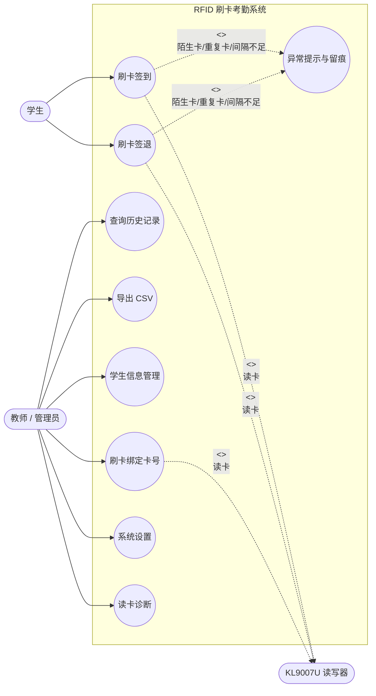
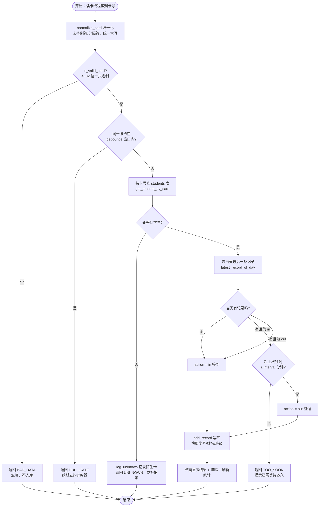
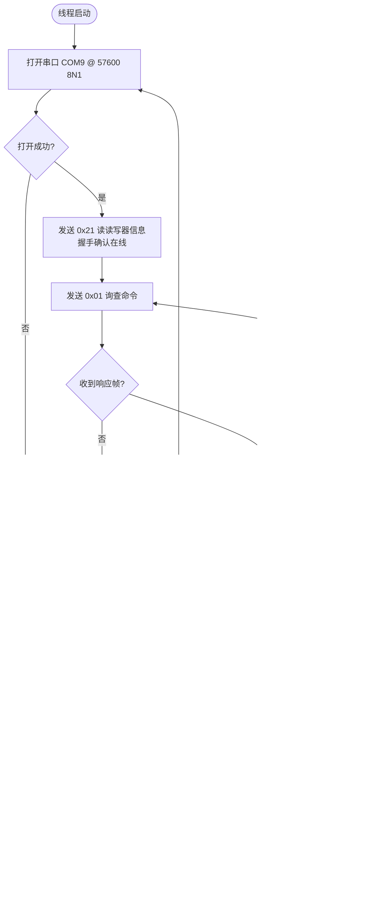
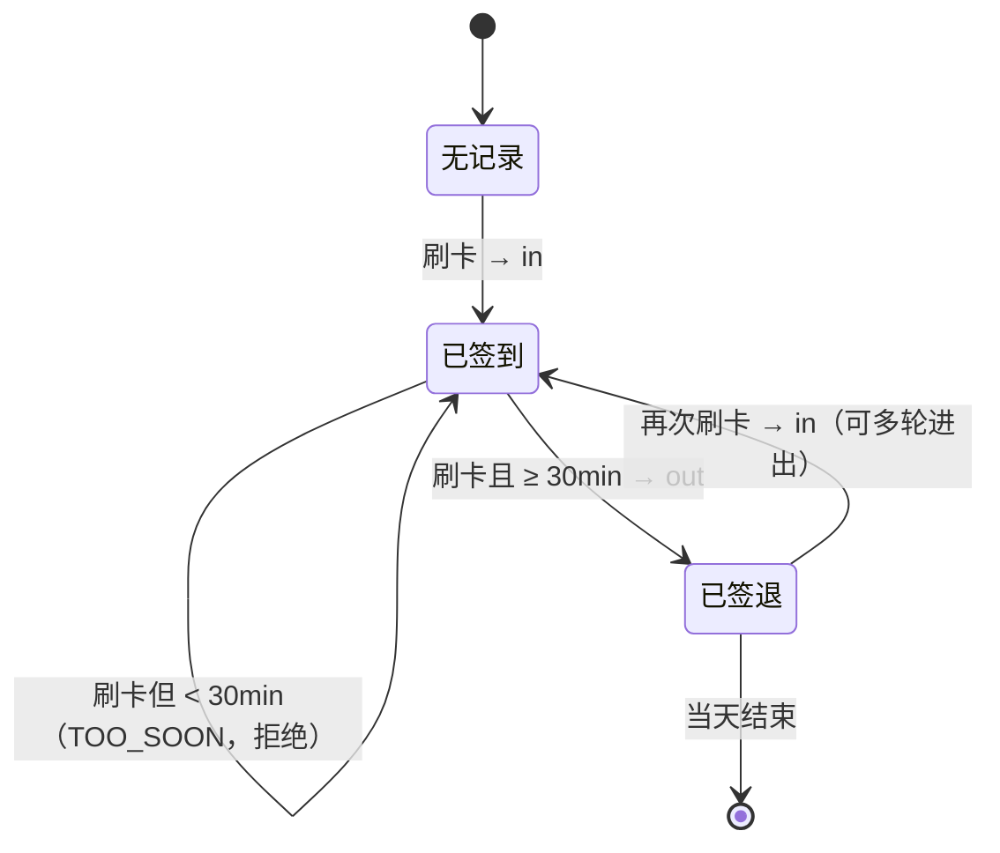
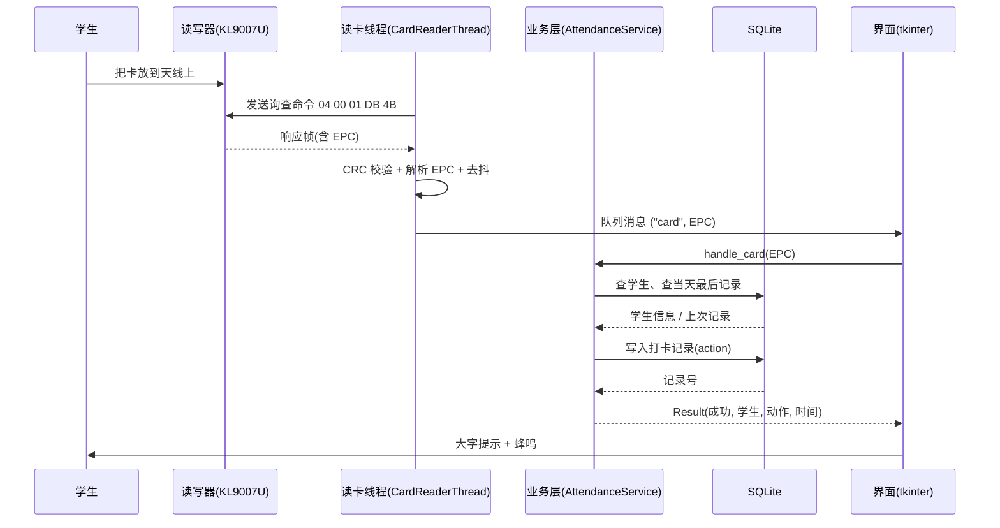

# 02 用例图与活动图

> 图形用 Mermaid 语法描述，可在支持 Mermaid 的编辑器（VS Code / Typora / 语雀）
> 或在线 https://mermaid.live 直接渲染。流程与 `attendance.py` 代码逐节点对应。

---

## 1. 用例图

参与者：**学生**（刷卡）、**教师/管理员**（管理学生、查记录、配置）；
外部系统：**KL9007U 读写器**（被系统驱动）。

**用例说明**

| 用例 | 前置条件 | 基本流 | 备选流 |
|---|---|---|---|
| 刷卡签到 | 卡已绑定学生 | 刷卡→读卡→首次打卡→写库(action=in)→提示成功 | 陌生卡/重复卡/脏数据 |
| 刷卡签退 | 当天已签到且间隔足够 | 刷卡→读卡→判定为签退→写库(action=out)→提示成功 | 间隔不足→提示还需等待 |
| 学生信息管理 | 已登录界面 | 增删改查学生，可刷卡自动填卡号 | 学号/卡号重复→提示 |
| 系统设置 | — | 修改间隔/串口等参数并保存 | 非法数值→回退默认 |

---

## 2. 活动图：完整的"刷卡 → 判定"流程

这是最核心的一张图，对应 `AttendanceService.handle_card()`。

---

## 3. 活动图：串口读卡线程（协议层 + 容错）

对应 `uhf_reader.py: CardReaderThread.run()`。

---

## 4. 活动图：签到 / 签退状态机

同一天内，同一学生的状态迁移（简洁版，便于口头讲解）：

---

## 5. 时序图：一次成功刷卡的完整交互

